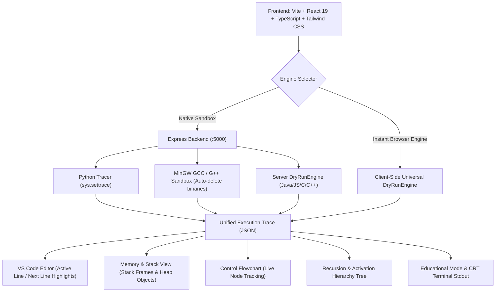

# Cyber-Tutor v2.0 PRO: Advanced Visual Code Execution & Memory Tracer

**Cyber-Tutor** is a modern, high-fidelity visual dry-run debugger and execution visualizer inspired by [PythonTutor](https://pythontutor.com), reimagined with a retro-futuristic Cyberpunk/Synthwave aesthetic, true stack-and-heap memory representations, pointer address tracking (for C/C++), dynamic control flowcharts, recursion activation trees, and pedagogical educational mode insights.

---

## 🌟 Key Architecture & Capabilities



---

## 🎨 UI & Design Aesthetics

- **Color Palette**: Dark obsidian background (`#050811`), neon cyan (`#00f0ff`), neon purple (`#c084fc`), electric blue (`#38bdf8`), cyber green (`#4ade80`), and neon amber (`#fbbf24`).
- **Glassmorphic Panels**: Backdrop blur (`blur(12px)`), 1px glowing cyber borders, and high contrast typography using Google Fonts (**JetBrains Mono**, **Fira Code**, **Inter**).
- **Retro Computing Touches**:
  - CRT Scanline Standard Output terminal screen with real-time streaming and phosphor glow cursor.
  - Interactive Web Audio API sound synthesizer for tactile mechanical step clicks, success chimes, and error buzzers (toggleable).
  - Confetti celebration upon clean execution completion.

---

## 🔬 Multi-Language Support & Memory Mechanics

| Language | Engine & Execution Strategy | Memory Representation |
| :--- | :--- | :--- |
| **Python** | Native `sys.settrace` sandbox with incremental stdout | Activation records, local/global frames, heap lists, dicts, custom class instances. |
| **C** | MinGW GCC compilation check + DryRunEngine with hex addresses | Stack addresses (e.g., `0x7ffd5100`), pointer arrows (`int* p = &x`), dereference updates (`*p = 99`), `malloc` and `free`. |
| **C++** | MinGW G++ compilation + Reference & Class tracer | Objects instantiated via `new`, pointer vs reference (`int& ref`), heap blocks. |
| **Java** | High-fidelity JVM activation simulator | JVM stack frames, `args`, `new Node()` heap allocation, chained object references. |
| **JavaScript** | Scoped execution & AST simulation | Global/lexical closures, nested objects, array mutations, `console.log`. |

---

## ⚙️ How to Run Locally

### 1. Start Both Backend & Frontend Concurrently:
```bash
npm run dev
```
- **Frontend App**: `http://localhost:3000`
- **Backend API Server**: `http://localhost:5000`

### 2. Run Independently:
```bash
# Start Backend
node server/server.js

# Start Frontend
npm --prefix client run dev
```

### 3. Production Build:
```bash
npm run build
```

---

## 🛡 Security & Privacy-First Architecture

1. **Local Sandboxing**: All code executes directly on the user's local machine. No external cloud execution.
2. **Resource Limits**: 5-second hard execution timeout and a 1,000-step ceiling to prevent infinite loop browser freezes.
3. **Zero Retention**: Compiler outputs (`temp.exe`) and temporary source files are erased immediately in `finally` blocks.
4. **Data Privacy**: No code entered by users or execution traces are ever stored to disk or external databases.
