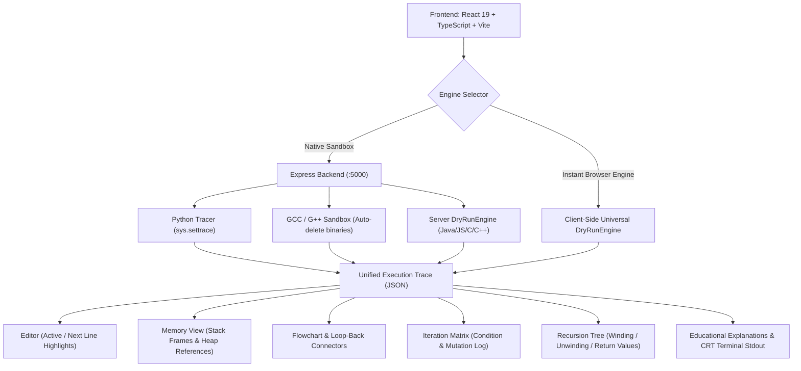

# CodeGraph: Visual Code Execution & Memory Tracer

[](https://render.com)
[](https://railway.app)
[](https://opensource.org/licenses/MIT)

**CodeGraph** is a modern, high-fidelity visual dry-run execution visualizer inspired by [PythonTutor](https://pythontutor.com). Designed with an editorial aesthetic, it features true stack-and-heap memory representations, pointer address tracking (C/C++), dynamic control flowcharts with loop-back connectors, an Iteration Matrix, and a dual-phase Recursion Tree viewer (winding vs. unwinding).

---

## 🌟 Key Architecture & Capabilities



---

## 🔬 Multi-Language Support & Memory Mechanics

| Language | Engine & Execution Strategy | Memory Representation |
| :--- | :--- | :--- |
| **Python** | Native `sys.settrace` sandbox with incremental stdout | Activation records, local/global frames, heap lists, dicts, custom class instances. |
| **C** | GCC compilation check + DryRunEngine with hex addresses | Stack addresses (e.g., `0x7ffd5100`), pointer arrows (`int* p = &x`), dereference updates (`*p = 99`), `malloc` and `free`. |
| **C++** | G++ compilation + Reference & Class tracer | Objects instantiated via `new`, pointer vs reference (`int& ref`), heap blocks. |
| **Java** | High-fidelity JVM activation simulator | JVM stack frames, `args`, `new Node()` heap allocation, chained object references. |
| **JavaScript** | Scoped execution & AST simulation | Global/lexical closures, nested objects, array mutations, `console.log`. |

---

## 🚀 Quick Start (Local Development)

### 1. Install & Run Dev Server:
```bash
# Clone the repository
git clone https://github.com/kiracode-s/CodeGraph.git
cd CodeGraph

# Install all dependencies
npm run install-all

# Start both backend and frontend concurrently
npm run dev
```

- **Frontend App**: `http://localhost:3000`
- **Backend API Server**: `http://localhost:5000`

---

## 📦 Production Deployment

### Option 1: Docker (Recommended)
Build and run the container with all language compilers pre-installed:
```bash
docker build -t codegraph .
docker run -p 5000:5000 codegraph
```
Visit `http://localhost:5000`.

### Option 2: 1-Click Cloud Deploy
- **Railway**: Connect repository; Railway detects `railway.json` and builds via Dockerfile automatically.
- **Render**: Connect repository; Render reads `render.yaml` blueprint with healthcheck at `/api/health`.
- **Fly.io**: Run `fly launch` and `fly deploy`.

### Option 3: Unified Fullstack Host (Heroku / VPS / Node)
```bash
# Build frontend and install production server dependencies
npm run build

# Start the unified production server (serves frontend + API on single port)
npm start
```

For split frontend (Vercel) + backend (Render) deployments, see [DEPLOYMENT.md](file:///c:/Users/Saurav/Downloads/New%20folder%20(3)/tutor/DEPLOYMENT.md).

---

## 🛡 Security & Privacy
1. **Execution Timeouts**: 5-second hard execution timeout and a 1,000-step ceiling prevent infinite execution lockups.
2. **Ephemeral Binaries**: Compiler outputs and temporary source files are purged immediately from temporary storage.
3. **Zero Retention**: User code and execution traces are processed in-memory and never persisted to external storage.

---

## 📄 License
MIT License. Created by [kiracode-s](https://github.com/kiracode-s).
